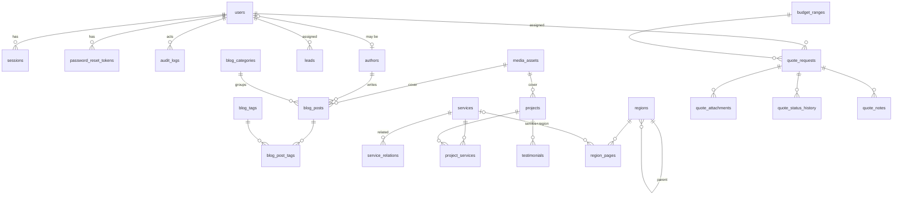

# Veritabanı

PostgreSQL 18 (Neon'da doğrulandı). `0000_init` 2026-11-04'te uygulandı; seed çalıştırıldı (6 hizmet, 18 ilişki, 8 teklif seçeneği, 5 bütçe aralığı, Ankara + 25 ilçe, 5 sayfa, 5 blog kategorisi, 3 site ayarı). Şema: `src/lib/db/schema/*.ts` (Drizzle, `casing: snake_case`). Migration: `drizzle/` (sürümlü SQL).

## ERD

## Brief'teki modellerin karşılığı

| Model | Tablo | Not |
|---|---|---|
| User / Role / Session | `users` (`role` enum), `sessions` | 3 sabit rol için ayrı tablo gereksiz; enum + kod içi izin matrisi |
| SiteSetting | `site_settings` | anahtar → jsonb; SMTP parolası AES-256-GCM şifreli |
| Page | `pages` | kurumsal + yasal; `requires_legal_review` |
| Service | `services`, `service_relations` | `is_core`: mevcut hizmet / onay bekleyen öneri |
| BlogPost/Category/Tag/Author | `blog_posts`, `blog_categories`, `blog_tags`, `blog_post_tags`, `authors` | zamanlanmış yayın = `published` + gelecek `published_at` |
| MediaAsset | `media_assets` | varyantlar jsonb |
| Project / Testimonial | `projects` (`client_consent`), `testimonials` (`consent_at`) | izin yoksa yayınlanamaz (servis katmanında zorunlu) |
| Region / District / Neighborhood | `regions` (`kind`: city/district/neighborhood/zone) | tek hiyerarşik tablo; semt ve OSB = `zone` |
| RegionLandingPage | `region_pages` | `(region_id, service_id)` NULLS NOT DISTINCT unique |
| SeoMetadata | `seoColumns()` sütun grubu | her içerik tablosunda aynı 8 sütun; join yok, FK bütünlüğü var |
| RedirectRule | `redirect_rules` | |
| QuoteRequest / StatusHistory / Note | `quote_requests`, `quote_status_history`, `quote_notes`, `quote_attachments` | numara `quote_number_seq` → `LGN-2026-001001` |
| Lead | `leads` (`source`: contact / seo_audit) | |
| Notification | `notifications` | gönderim durumu ve hata |
| AuditLog | `audit_logs` | |
| ContentRevision | `content_revisions` | her kayıttan önce anlık görüntü |
| — | `quote_service_options`, `budget_ranges`, `rate_limits` | admin'den yönetilen seçenekler, ortak rate limit |

## Kurallar

- ID: UUID v4 (`gen_random_uuid()`), dış dünyaya sıralı ID sızmaz; teklif numarası ayrı sekans
- Tüm zamanlar `timestamptz`
- Slug'lar unique; bölgelerde `(parent_id, slug)` unique
- Silme: içerik bağları `restrict` / `set null`; bağımlı kayıtlar (not, geçmiş, ek) `cascade`
- İndeksler: liste ekranlarının filtre + sıralama sütunları (`status, created_at` vb.)

## Migration ve seed

- `npm run db:generate` → yeni SQL; **elle gözden geçirilir**. `DROP`/`ALTER ... TYPE`/`NOT NULL` ekleme içeren migration'lar deploy betiğinde otomatik uygulanmaz, onay ister
- `npm run db:migrate` → `DATABASE_URL_DIRECT` üzerinden (Neon pooler çok komutlu transaction'ları sessizce düşürebilir)
- `npm run db:seed` → idempotent `INSERT ... ON CONFLICT DO NOTHING`; mevcut kaydı silmez/ezmez
- Admin hesabı seed'de oluşturulmaz: `npm run admin:create -- <eposta> "<Ad>"` parolayı terminalde sorar
